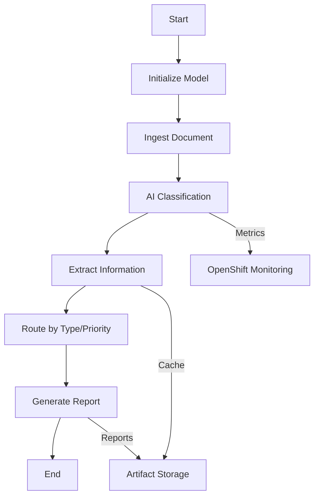

# Full AI Document Processing Workflow Guide

## Overview

The full AI document processing workflow template (`ai-workflow-template-full.yaml`) implements a complete document processing pipeline with AI-powered classification, extraction, routing, and report generation.

## Workflow Architecture



## Workflow Steps

### 1. **Model Initialization** (`init-ollama-model`)
- Checks if the requested model is already loaded in Ollama
- Pulls the model if not present
- Ensures model is ready before processing

### 2. **Document Ingestion** (`document-ingestion`)
- Downloads document from provided URL
- Stores in MinIO for artifact management
- Captures metadata (size, source, project)

### 3. **AI Classification** (`llm-classify-monitored`)
- Uses AI to classify documents into 6 types:
  - Invoice
  - Contract
  - Report
  - Correspondence
  - Technical Documentation
  - Other
- Determines priority level:
  - Urgent
  - Normal
  - Low
- Provides confidence scores
- Captures processing metrics

### 4. **Information Extraction** (`llm-extract-cached`)
- Type-specific extraction templates
- Extracts relevant fields based on document type:
  - **Invoice**: vendor, amount, due date, invoice number, line items
  - **Contract**: parties, term, value, obligations, termination clause
  - **Report**: executive summary, findings, recommendations, metrics
  - **Technical Doc**: overview, requirements, architecture, dependencies
  - **Correspondence**: sender, recipient, subject, action items, deadlines
  - **Other**: summary, key points, entities, dates
- Implements caching for efficiency

### 5. **Intelligent Routing** (`route-processor`)
- Routes documents based on type and priority
- Applies business rules:
  - **Urgent**: 4-hour SLA, immediate escalation, multi-channel notifications
  - **Normal**: 24-hour SLA, standard escalation, email notifications
  - **Low**: 72-hour SLA, no escalation, no notifications
- Determines next steps based on document type

### 6. **Report Generation** (`generate-final-report`)
- Creates executive summary using AI
- Generates comprehensive markdown report
- Includes all metadata and processing information
- Creates JSON summary for integration

## Document Types and Processing

### Invoice Processing
- **Extraction**: Vendor details, amounts, dates, line items
- **Urgent Handling**: Fast-track payment approval, finance team notification
- **Use Cases**: AP automation, payment processing, vendor management

### Contract Processing
- **Extraction**: Parties, terms, obligations, clauses
- **Processing**: Legal review requirement, stakeholder meetings
- **Use Cases**: Contract management, compliance tracking, renewal alerts

### Report Processing
- **Extraction**: Summary, findings, recommendations
- **Distribution**: Leadership distribution, review sessions
- **Use Cases**: Business intelligence, decision support, performance tracking

### Technical Documentation
- **Extraction**: Architecture, requirements, dependencies
- **Processing**: Technical review, documentation updates
- **Use Cases**: System documentation, API specs, deployment guides

### Correspondence
- **Extraction**: Parties, subjects, action items
- **Tracking**: Deadline monitoring, response tracking
- **Use Cases**: Email processing, letter handling, communication management

## Usage Examples

### Basic Submission
```bash
./submit-test-workflow.sh -d "https://example.com/document.pdf"
```

### With Custom Model
```bash
oc create -f - <<EOF
apiVersion: argoproj.io/v1alpha1
kind: Workflow
metadata:
  generateName: ai-doc-custom-
  namespace: argo-ai-demo
spec:
  workflowTemplateRef:
    name: ai-document-processor
  arguments:
    parameters:
    - name: doc-url
      value: "https://example.com/important-invoice.pdf"
    - name: model
      value: "mistral:7b"
EOF
```

### Monitoring Execution
```bash
# Watch workflow progress
argo watch -n argo-ai-demo @latest

# View specific step logs
oc logs <pod-name> -n argo-ai-demo -c main

# Check artifacts in MinIO
mc ls myminio/argo-artifacts/<workflow-name>/ --insecure
```

## Outputs and Artifacts

### Stored Artifacts
1. **Original Document**: `argo-artifacts/<workflow-id>/document.txt`
2. **Extracted Data**: `argo-artifacts/<workflow-id>/extracted-<type>.json`
3. **Processed Result**: `argo-artifacts/<workflow-id>/processed-result.json`
4. **Final Report**: `argo-artifacts/<workflow-id>/final-report.md`
5. **Summary**: `argo-artifacts/<workflow-id>/summary.json`

### Report Contents
- Executive summary
- Document classification and confidence
- Extracted information
- Processing rules applied
- Recommended next steps
- Processing metrics
- Artifact locations

## Performance Considerations

### Model Selection
- **llama3.2:3b**: Fast, good for most documents
- **mistral:7b**: Better accuracy, slower processing
- **phi3:mini**: Balanced performance

### Optimization Tips
1. Pre-load frequently used models
2. Use appropriate model for document complexity
3. Monitor Ollama resource usage
4. Consider parallel processing for batches

## Troubleshooting

### Common Issues

1. **Model Not Found**
   - Ensure model is loaded: `./load-ollama-models.sh -m <model>`
   - Check Ollama status: `oc logs deployment/ollama -n argo-ai-demo`

2. **Classification Errors**
   - Check document format and encoding
   - Verify model is appropriate for content
   - Review prompt templates in workflow

3. **Slow Processing**
   - Monitor pod resources: `oc top pods -n argo-ai-demo`
   - Check Ollama model loading time
   - Consider using smaller models

4. **Extraction Failures**
   - Verify document content is readable
   - Check extraction templates match document type
   - Review AI response format

### Debug Commands
```bash
# Check workflow details
oc describe workflow <workflow-name> -n argo-ai-demo

# View classification results
oc logs <classify-pod> -n argo-ai-demo -c main

# Check stored artifacts
mc cat myminio/argo-artifacts/<workflow-id>/extracted-<type>.json --insecure | jq .
```

## Integration Points

### OpenShift Features Used
- **Routes**: External access to services
- **PVCs**: Model and artifact storage
- **ConfigMaps**: Workflow configuration
- **Secrets**: Credential management
- **RBAC**: Service account permissions

### Extensibility
- Add new document types in extraction templates
- Customize processing rules
- Integrate with external systems
- Add notification channels
- Implement custom validators

## Next Steps

1. **Production Deployment**
   - Scale Ollama replicas
   - Implement model caching
   - Add monitoring and alerting
   - Configure backup strategies

2. **Advanced Features**
   - Batch processing workflows
   - Multi-language support
   - OCR integration for images
   - Custom ML models

3. **Integration**
   - Connect to document management systems
   - API gateway for external access
   - Webhook notifications
   - Database storage for results
